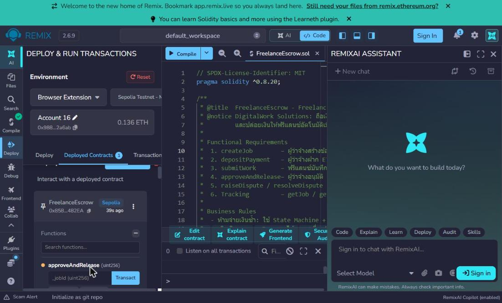
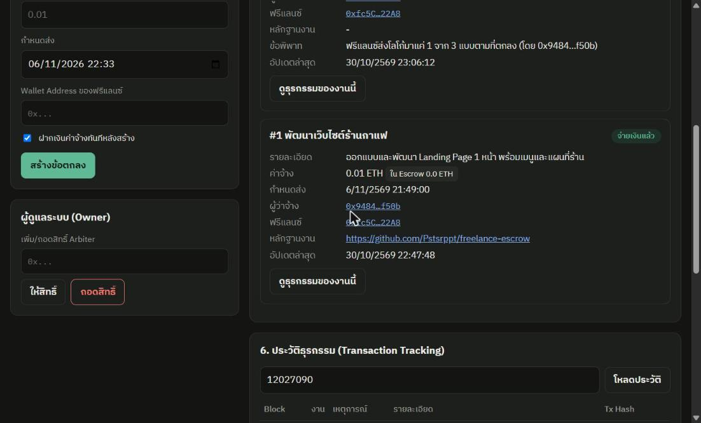
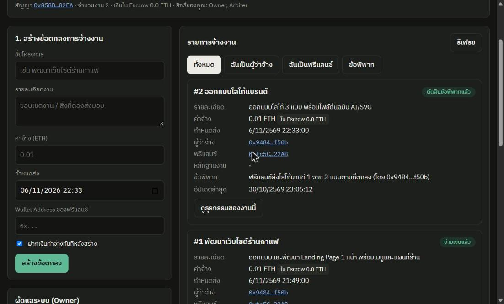
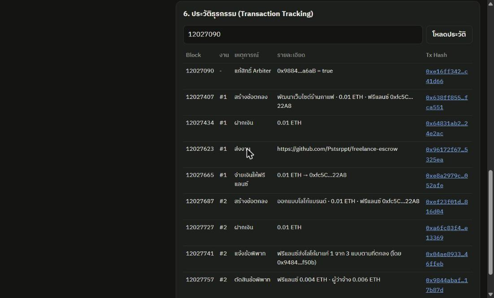

# Freelance Escrow & Smart Payment Platform

CSI301 · โจทย์ที่ 1 ระบบจ้างงานฟรีแลนซ์และชำระเงินตามผลงาน (DigitalWork Solutions)

Smart Contract ถือเงินค่าจ้างไว้แบบ Escrow และโอนให้ฟรีแลนซ์อัตโนมัติเมื่อผู้ว่าจ้างอนุมัติงาน พร้อมหน้าเว็บ dApp ที่เชื่อม MetaMask

| | |
|---|---|
| **หน้าเว็บ (GitHub Pages)** | https://pstsrppt.github.io/freelance-escrow/ |
| **Network** | Ethereum Sepolia Testnet |
| **Contract Address** | [`0x858BA7dB6caDe1F2c814b8830012fe2018c482EA`](https://sepolia.etherscan.io/address/0x858BA7dB6caDe1F2c814b8830012fe2018c482EA) |
| **Deploy Block** | 12027090 |
| **Etherscan** | ✅ Source Code Verified (Exact Match) |
| **Compiler** | Solidity 0.8.34 (Remix) · `pragma ^0.8.20` |

## โครงสร้างไฟล์

```
contracts/FreelanceEscrow.sol   Smart Contract
index.html                      หน้าเว็บ dApp (สร้างจาก scripts/build.js)
scripts/index.template.html     ต้นฉบับหน้าเว็บ (แก้ที่ไฟล์นี้)
scripts/build.js                compile สัญญา + ใส่ ABI ลงหน้าเว็บ
abi/FreelanceEscrow.abi.json    ABI ของสัญญา
test/contract.test.js           ทดสอบสัญญา 20 กรณี
test/ui.test.js                 ทดสอบหน้าเว็บแบบ end-to-end 12 กรณี
```

## ฟังก์ชันตาม Requirement

| Requirement | ฟังก์ชัน | ผู้เรียก | สถานะที่ต้องเป็น |
|---|---|---|---|
| 1. Create Contract | `createJob(title, description, amountWei, deadline, freelancer)` | ผู้ว่าจ้าง | – |
| 2. Deposit Payment | `depositPayment(jobId)` ส่ง ETH เท่ากับค่าจ้างพอดี | ผู้ว่าจ้าง | Created |
| 3. Submit Work | `submitWork(jobId, evidence)` | ฟรีแลนซ์ | Funded / Submitted, ก่อนกำหนดส่ง |
| 4. Approve & Release | `approveAndRelease(jobId)` | ผู้ว่าจ้าง | Submitted |
| 5. Dispute | `raiseDispute(jobId, reason)` · `resolveDispute(jobId, toFreelancerWei)` | คู่สัญญา · Arbiter | Funded/Submitted · Disputed |
| 6. Tracking | `getJob`, `getJobsByClient`, `getJobsByFreelancer` + Events | ทุกคน | – |
| เสริม | `cancelJob`, `refundAfterDeadline`, `setArbiter` | ผู้ว่าจ้าง / Owner | |

สถานะงาน: `0 Created → 1 Funded → 2 Submitted → 3 Released` หรือ `→ 4 Disputed → 5 Resolved`, `6 Refunded`, `7 Cancelled`

## กฎทางธุรกิจ

- **ห้ามจ่ายเงินซ้ำ**: ตรวจสถานะก่อน แล้วตั้ง `escrowBalance = 0` และเปลี่ยนเป็นสถานะปิด *ก่อน* โอน (Checks-Effects-Interactions) พร้อม `nonReentrant`
- **ห้ามเบิกก่อนเข้าเงื่อนไข**: ไม่มีฟังก์ชันถอนเงินทั่วไป เงินออกได้ 3 ทาง คือ ผู้ว่าจ้างอนุมัติ, Arbiter ตัดสินข้อพิพาท หรือคืนเงินเมื่อเลยกำหนดส่งแล้วไม่มีการส่งงาน
- ระหว่างข้อพิพาท ผู้ว่าจ้างอนุมัติจ่ายเองไม่ได้ และ Arbiter ต้องไม่ใช่คู่สัญญาของงานนั้น
- ETH ที่โอนเข้าสัญญาตรง ๆ ถูกปฏิเสธ (`receive()` revert)

## วิธีใช้หน้าเว็บ

1. เปิด https://pstsrppt.github.io/freelance-escrow/ ใน Chrome ที่ติดตั้ง MetaMask
2. กด **เชื่อมต่อ MetaMask** และเลือกเครือข่าย Sepolia (Contract Address กรอกไว้ให้แล้ว)
3. บทบาทในการสาธิต: **Admin/Arbiter** = บัญชีที่ deploy, **Client** = ผู้ว่าจ้าง, **Freelancer** = ฟรีแลนซ์

## พัฒนาและทดสอบ

```bash
npm install
npm run build          # compile สัญญาและสร้าง index.html ใหม่
npm run chain          # เปิด local chain (อีกหน้าต่าง terminal)
npm test               # ทดสอบสัญญา + หน้าเว็บ
```

## ผลการสาธิตบน Sepolia

| งาน | ขั้นตอน | ผล |
|---|---|---|
| #1 พัฒนาเว็บไซต์ร้านกาแฟ | สร้าง → ฝาก 0.01 ETH → ส่งงาน → อนุมัติ | ฟรีแลนซ์ได้ 0.01 ETH, อนุมัติซ้ำถูกปฏิเสธ (`already paid`) |
| #2 ออกแบบโลโก้แบรนด์ | สร้าง → ฝาก 0.01 ETH → แจ้งข้อพิพาท → Admin ตัดสิน | ฟรีแลนซ์ 0.004 ETH, คืนผู้ว่าจ้าง 0.006 ETH |

| | |
|---|---|
|  |  |
|  |  |
